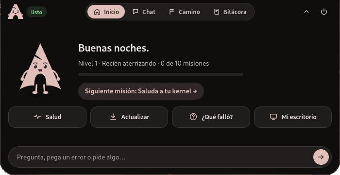
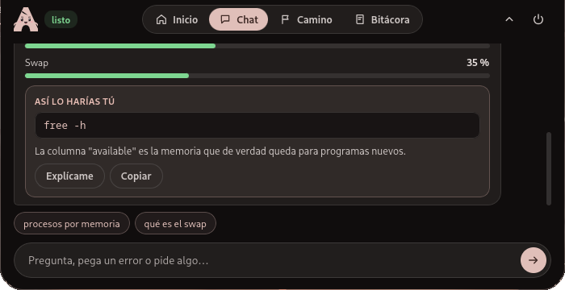
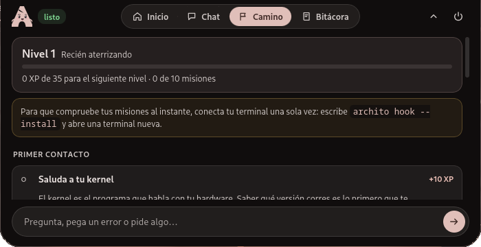
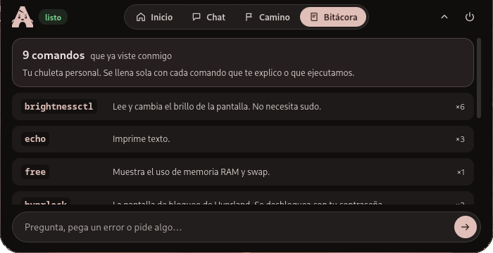

<div align="center">



# Archito

**Un compañero local para aprender Arch Linux.**<br>
Vive como una isla en el borde superior de la pantalla, explica cada comando antes de ejecutarlo,<br>traduce los errores y revisa el sistema contigo.

[](https://github.com/fabiiianac15/Archito/releases/tag/appimage)
[](LICENSE)
[](crates/archito-core)
[](app)
[](#se-adapta-a-tu-escritorio)

<a href="https://github.com/fabiiianac15/Archito/releases/download/appimage/Archito-x86_64.AppImage"></a>

*No reemplaza la terminal. Te ayuda a entenderla hasta que ya no lo necesites.*

</div>

## Así se ve

Recogida, Archito es una píldora en el borde de arriba. Un clic (o tu atajo) la abre:

<p align="center"></p>

<table>
  <tr>
    <td width="50%"></td>
    <td width="50%"></td>
  </tr>
  <tr>
    <td align="center"><b>Inicio</b> · tu nivel, la siguiente misión y accesos rápidos</td>
    <td align="center"><b>Chat</b> · respuestas con datos de tu equipo y el comando real</td>
  </tr>
  <tr>
    <td></td>
    <td></td>
  </tr>
  <tr>
    <td align="center"><b>Camino</b> · misiones que comprueba en tu sistema real</td>
    <td align="center"><b>Bitácora</b> · tu chuleta, que se llena sola</td>
  </tr>
</table>

Los colores no vienen fijos: la isla toma los de tu escritorio. Estas capturas usan una paleta de matugen sacada del fondo de pantalla; con otro fondo, otro tema o KDE, se ve con esos colores.

### Archito tiene cara

El personaje cambia de pose según lo que pasa en tu sistema:

<p align="center"></p>

## Por qué

Mucha gente abandona Arch en el primer error que no entiende. Archito está pensado para ese momento: en vez de esconder los comandos, los muestra, los desarma pieza por pieza y comprueba en tu equipo real que lo que aprendiste funcionó.

## Estado

Versión 0.6.0, en desarrollo activo.

El proyecto está pasando de Python + GTK4 a Rust + Tauri. El núcleo, la CLI y la isla nuevos ya funcionan. La versión en Python sigue en `src/` como referencia hasta que la nueva cubra todo lo que hacía (ver [Qué falta por portar](#qué-falta-por-portar)).

## Qué hace

### Te enseña

- **Camino.** Diez misiones cortas en cuatro etapas, con niveles y experiencia. Las haces tú en tu terminal y Archito comprueba que las hiciste mirando el historial de tu shell y el registro de pacman.
- **Así lo harías tú.** Cada respuesta sobre tu sistema incluye el comando real que hay detrás, con un botón para explicarlo.
- **Modo profesor.** Toda acción llega con su comando desarmado: qué es `sudo`, qué hace `-Syu`, qué es el último argumento. Viene activado.
- **Glosario.** 24 términos (kernel, AUR, systemd, pacnew, swap…) explicados en claro, cada uno con un comando para verlo en tu equipo.
- **Bitácora.** Cada comando que ves se apunta con su explicación. Es tu chuleta personal y se llena sola.

### Traduce errores

- Pega un mensaje de error en el chat y Archito te dice qué pasó, por qué y qué hacer. Reconoce los más comunes de pacman, systemd y permisos.
- Con el hook de la shell instalado, `archito porque` explica el último comando que falló sin que tengas que copiar nada.

### Revisa tu sistema

- Guías que investigan antes de responder: "no tengo sonido", "no tengo internet", "va lento", "no arranca". Miran los servicios reales de tu equipo y dicen cuál falla.
- Estado de salud, CPU, memoria, disco, temperatura, procesos, batería, servicios fallidos y errores del registro.
- Paquetes: buscar, instalar, quitar, actualizar con aviso de qué piezas centrales cambian, huérfanos y caché.

### Se adapta a tu escritorio

Al arrancar, Archito detecta tu escritorio (Hyprland, Sway, niri, KDE Plasma, GNOME, COSMIC, Xfce, gestores de X11…), si la sesión es Wayland o X11, tu distro (Arch, CachyOS, EndeavourOS, Manjaro, Garuda, Artix…) y tu ayudante del AUR. Con eso:

- **Capturas, bloqueo, brillo y volumen** usan la herramienta que de verdad tienes: `hyprshot` o `grim` en Hyprland, `spectacle` en KDE, `gnome-screenshot` en GNOME, `hyprlock`, `swaylock` o `loginctl lock-session` para bloquear, `brightnessctl`, `wpctl` o `pactl`. Si falta, te dice qué paquete instalar.
- Estas acciones de escritorio se lanzan al momento, sin abrir una terminal. Solo pasan las que el clasificador reconoce como tales (`safety::is_desktop_action`): un único comando de esa lista, sin `sudo` ni redirecciones.
- "Qué escritorio uso" resume todo lo detectado y te da la línea exacta para el atajo de la isla en *tu* escritorio, incluido Hyprland con configuración en Lua.
- Al actualizar, avisa si cambian piezas de tu escritorio (por ejemplo `hyprland` o `kwin`).

## La isla

En el escritorio, Archito es una píldora pegada al borde superior, al centro. Al arrancar, el personaje baja colgado de un hilo, saluda y se mete en la píldora. Un clic la abre con un resorte hasta un panel de tamaño fijo:

- Arriba, la cara de Archito con su estado, las pestañas (Inicio, Chat, Camino, Bitácora) y dos botones: recoger y cerrar el programa. Cerrar pide un segundo clic para confirmar.
- En medio, la vista elegida. Inicio muestra a Archito, tu nivel, tu siguiente misión y cuatro accesos rápidos.
- Abajo, la caja de texto, disponible en todas las vistas.

**Colores.** La isla se viste con los colores de tu escritorio: la paleta Material You de matugen (Quickshell, Noctalia, Caelestia), pywal, KDE, el GTK generado o el acento de GNOME, en ese orden. Si cambias el fondo de pantalla y tu tema se regenera, la isla cambia sola en un par de segundos. Si no encuentra nada, usa el azul de Arch. `archito --tema` muestra qué colores detecta y de dónde salen.

**El personaje.** Archito es un SVG por piezas que cambia de pose según lo que pasa: parpadea y mira a los lados en reposo, piensa mientras trabaja, se preocupa con un aviso, salta cuando cumples una misión, se duerme si lo dejas unos minutos y se despide al cerrar. Con "reducir movimiento" activado en el sistema, no se anima.

El color del borde y del punto indica el estado (listo, pensando, atención, error). Fuera de la forma de la isla, los clics pasan a la ventana de abajo.

Funciona en compositores Wayland con layer-shell: Hyprland, Sway, KDE Plasma y COSMIC. En GNOME y en X11 se abre como una ventana normal sin bordes.

## Arquitectura

```text
            ┌──────────────────────────────┐
            │         archito-core         │   Rust, sin interfaz
            │  intenciones · sondas        │
            │  seguridad · explicador      │
            │  errores · misiones          │
            └──────┬────────────────┬──────┘
                   │                │
          ┌────────┴──────┐  ┌──────┴────────────┐
          │  archito-cli  │  │   archito-panel   │
          │   terminal    │  │ Tauri + TypeScript│
          └───────────────┘  └───────────────────┘
                   ▲
                   │  apunta cada comando y su resultado
          ┌────────┴──────┐
          │ hook de shell │   fish · zsh · bash
          └───────────────┘
```

| Ruta | Qué contiene |
|---|---|
| `crates/archito-core/` | El núcleo. `brain.rs` decide la intención, `probe.rs` lee el sistema, `desktop.rs` detecta escritorio, distro y herramientas, `theme.rs` lee los colores del escritorio, `safety.rs` clasifica el riesgo, `explain.rs` desarma comandos, `errors.rs` traduce errores, `lessons.rs` lleva el camino, `glossary.rs` y `memory.rs` completan el resto. |
| `crates/archito-cli/` | El binario `archito` para la terminal. |
| `app/src-tauri/` | El backend de la isla: comandos hacia el núcleo y la capa layer-shell (`layer.rs`). |
| `app/src/` | La interfaz en TypeScript sin framework. `island.ts` anima la forma, `mascot.ts` dibuja y mueve al personaje, `intro.ts` hace la entrada, `theme.ts` aplica los colores y `main.ts` pinta las vistas. |
| `shell/` | Los hooks para fish, zsh y bash. |
| `src/`, `legacy/` | La versión anterior en Python. |

El núcleo no sabe nada de ventanas. La CLI y la isla usan la misma librería, y un futuro Arch Mobile haría lo mismo.

## Seguridad

- **Las sondas solo leen.** Nada en `probe.rs` cambia el equipo.
- **El riesgo lo decide el clasificador.** Analiza cada tramo del comando por separado, así que `pacman -Qi bash; rm -rf ~` sale como peligroso aunque empiece con una lectura.
- **Tres niveles.** Lectura (se ejecuta dentro del chat), cambio (se abre en una terminal visible, tras confirmar) y peligroso (advertencia aparte y doble confirmación). Las acciones de escritorio (captura, bloqueo, brillo, volumen) son cambios que se lanzan sin terminal y sin shell.
- **La interfaz no manda comandos.** Solo envía el número de una acción que el núcleo propuso antes. El texto que se ejecuta es el que guardó el núcleo.
- **Todo es local.** La memoria vive en `~/.config/archito/`. No hay telemetría ni llamadas a servicios externos.

## Instalación

### AppImage

Un solo archivo, sin instalar nada. El enlace descarga siempre la versión más reciente:

**[Archito-x86_64.AppImage](https://github.com/fabiiianac15/Archito/releases/download/appimage/Archito-x86_64.AppImage)**

```bash
chmod +x Archito-x86_64.AppImage
./Archito-x86_64.AppImage
```

Se reconstruye sola en cada cambio que llega a `master` (ver `.github/workflows/appimage.yml`). Trae la isla y, dentro, la CLI. Pesa unos 110 MB porque lleva su propio motor web.

Para construirla en tu equipo: `./scripts/appimage.sh`. Queda en `dist/Archito-x86_64.AppImage`.

<details>
<summary><b>Desde el código</b></summary>

#### Dependencias

```bash
sudo pacman -S rustup nodejs npm webkit2gtk-4.1 gtk-layer-shell
rustup default stable
```

Opcionales, para sacarle más partido:

```bash
sudo pacman -S pacman-contrib pkgfile   # checkupdates, paccache, y saber qué paquete trae un comando
sudo pkgfile --update
```

#### Compilar

```bash
cargo build --release                        # núcleo y CLI
cd app && npm install && npx tauri build --no-bundle   # la isla
```

Los binarios quedan en `target/release/`: `archito` (CLI) y `archito-panel` (isla).

La primera compilación de la isla tarda varios minutos. En equipos con poca memoria, el primer arranque justo después de compilar puede tardar unos segundos en pintarse.

</details>

## Uso

### En la terminal

```bash
archito                          # conversación
archito cuánta ram tengo         # una pregunta y sale
archito explica sudo pacman -Syu # desarma un comando
archito porque                   # explica el último comando que falló
archito camino                   # tu siguiente misión
archito comprobar                # comprueba la misión en curso
archito hook --install           # conecta tu shell
```

### La isla

```bash
archito-panel                    # la abre; lanzarlo otra vez la abre o la recoge
archito-panel --camino           # la abre en una vista concreta
archito-panel no tengo sonido    # la abre con una pregunta
archito-panel --cerrar           # se despide y cierra el programa
```

Para tenerla en un atajo, pregúntale a Archito "qué escritorio uso": te da la línea para tu escritorio. En Hyprland:

```ini
# hyprland.conf
bind = SUPER, space, exec, archito-panel
```

```lua
-- hyprland.lua
hl.bind("SUPER + space", hl.dsp.exec_cmd("archito-panel"))
```

En `hyprland/` están `archito.conf` y `archito.lua` con el atajo y el blur de la isla.

Dentro de la isla, `Esc` la recoge y las flechas arriba y abajo recorren lo que ya escribiste.

### El hook de la shell

`archito hook --install` añade una función pequeña a tu shell que apunta cada comando y si terminó bien o mal. Con eso, `archito porque` sabe qué falló y el camino comprueba tus misiones al instante.

Los datos se guardan en `$XDG_RUNTIME_DIR/archito/`, una carpeta en memoria, privada, que se borra al cerrar sesión. En fish queda activo al abrir una terminal nueva. En zsh y bash el instalador te muestra la línea que debes añadir a tu archivo de inicio, porque Archito no edita ese archivo por ti.

## Desarrollo

```bash
cargo test                       # pruebas del núcleo
cd app && npm run tauri dev      # la isla con recarga en caliente
ARCHITO_DEBUG=1 archito-panel    # trazas de arranque de la capa
```

Con `ARCHITO_DEBUG=1`, los errores de JavaScript de la isla también salen en la terminal (en una compilación release no hay consola de WebKit).

Variables útiles: `ARCHITO_CONFIG_DIR` cambia dónde se guarda la memoria, `ARCHITO_RUNTIME_DIR` dónde escribe el hook y `ARCHITO_LAYER_SHELL=0` abre la isla como ventana normal.

## Qué falta por portar

La versión en Python hace cosas que la nueva todavía no:

- IA local opcional con Ollama
- comandos personalizados en JSON

Lo siguiente en la lista es la IA local con respuesta en streaming, apoyada en la Arch Wiki sin conexión (`arch-wiki-docs`) para que cite lo que dice. Después vienen las animaciones y los sonidos del personaje.

La versión en Python se sigue pudiendo usar con `./install.sh` o `PYTHONPATH=src python -m archito` (necesita `gtk4`, `python-gobject` y `gtk4-layer-shell`).

## Hoja de ruta

La visión completa, por fases, está en [`Archito — Roadmap Maestro del Proyecto.md`](<Archito — Roadmap Maestro del Proyecto.md>). Los principios que guían cada decisión son privacidad, transparencia, seguridad, educación y libertad.

## Contribuir

Las contribuciones son bienvenidas: haz un fork, crea una rama, comprueba que `cargo test` pasa y abre un pull request explicando el cambio.

Donde más ayuda hace falta:

- más misiones para el camino y más errores en el traductor
- pruebas en otros compositores (Sway, KDE, COSMIC, GNOME)
- más términos en el glosario
- traducciones

## Créditos

La forma de montar una ventana de Tauri como superficie layer-shell con región de entrada viene de [Coucou](https://github.com/Louis-CFM/coucou) (código bajo licencia MIT), que también inspiró el formato de isla. El personaje, el nombre y el resto del código de Archito son propios.

## Licencia

MIT. Consulta [LICENSE](LICENSE).
